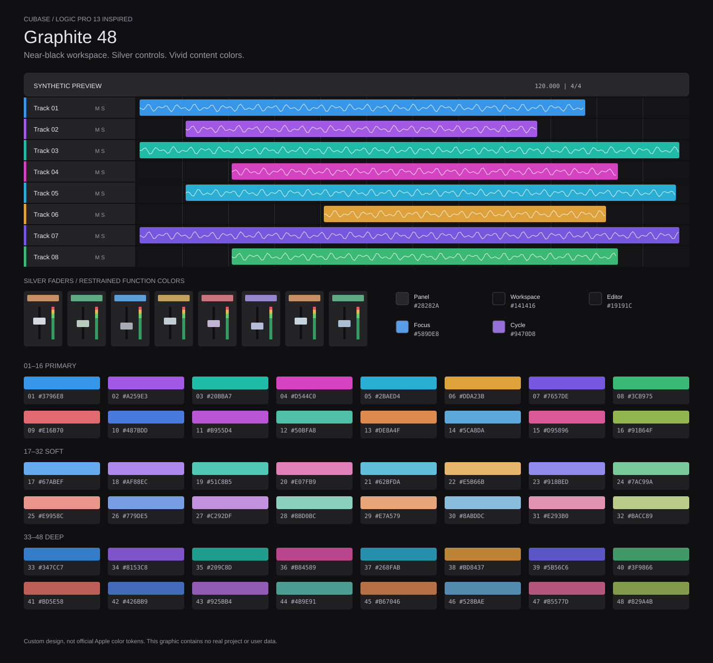

# Cubase · Logic 13-inspired Graphite 48

给 Cubase 的一套完整深色配色方案，以及**离线应用、验证和回退工具**。主要参考 Logic Pro 13 新版方向：近黑工作区、石墨灰面板、银灰推子，鲜明的蓝 / 紫 / 紫红 / 青绿留给轨道内容。

**原厂 16 色全部替换为重新设计的 48 色，不是在原色板后面追加。**

> 当前验证目标：**Windows + Cubase 14**。Python **3.10+**，仅标准库，无第三方依赖。其他平台/版本属于实验性迁移，不能承诺直接兼容。
>
> 这是自定义主题，不是苹果官方色板；不修改程序皮肤，也不能给 Cubase 添加 Liquid Glass。



*以上为根据主题参数生成的配色示意，并非真实工程截图或 Cubase 布局承诺。仓库不包含私人工程、音频、完整偏好设置或实际工程截图。*

## 换设备后，直接把这段话给 agent

> 请按照本仓库的 `AGENTS.md` 和 `README.md`，把完整 Logic Pro 13-inspired Graphite 48 配色应用到本机 Cubase。先检测版本和配置目录，运行 inspect 与 dry-run；让我保存并完全退出 Cubase 后，备份并直接修改配置文件，再运行 verify，重开 Cubase 检查。不要覆盖我的快捷键、音频设备、路由和插件设置。原厂 16 色要全部换成新的 48 色，保留“上一条轨道颜色 +1”。如果是旧工程，需要另行载入默认色板；未经确认不要修改工程文件。所有本机配置和备份都不要上传 GitHub。

## 包含哪些配色

| 范围 | 设计 |
|---|---|
| 主界面 | 13 个公开配色项：面板、焦点、编曲/编辑器背景与网格、标尺、循环区 |
| 轨道色板 | 48 色：16 个主色 + 16 个柔和变体 + 16 个深色变体 |
| 轨道类型默认色 | 9 类全部设置；顺序配色模式仍为 previous color +1 |
| 混音台推子 | 11 类银灰推子，保留轻微色相区别 |
| Channel Strip | 6 类协调的功能强调色 |
| 机架 | 21 项，包括插入、发送、EQ、路由、调制器等 |
| 电平表 | 15 套刻度的颜色统一；保留原有分界位置、标志和测量模式 |
| MIDI 编辑器 | 音高、通道、力度、声部、和弦/音阶、网格匹配，共 6 套 |
| 辅助色板 | Note Expression、Score、SoundSlot、Symbol，共 4 套 |
| 显示细节 | 3 类光标，波形/音符亮度、事件不透明度与选中边框、轨道/通道染色强度 |

主要界面颜色：

| 用途 | HEX |
|---|---|
| 面板基色 | `#28282A` |
| 编曲背景 | `#141416` |
| 编辑器背景 | `#19191C` |
| 焦点蓝 | `#589DE8` |
| 活动循环紫 | `#9470D8` |

所有色值和字段映射集中在 [`themes/logic13-graphite48.json`](themes/logic13-graphite48.json)。没有绑定某台机器的用户名或磁盘路径。

## 快速开始

### 1. 获取仓库

```sh
git clone https://github.com/TallMessiWu/cubase-logic13-theme.git
cd cubase-logic13-theme
python --version
```

新安装的 Cubase 请先启动一次并正常退出，以生成完整配置。

### 2. 检查和预演（不写入）

```sh
python cubase_theme.py inspect
python cubase_theme.py apply --dry-run
```

Windows 自动查找 `%APPDATA%\Steinberg\Cubase*` 下同时包含两个配置文件的目录。如果发现多个版本/目录，会停止并要求明确指定，不会擅自选择。

PowerShell 中显式指定 Cubase 14：

```powershell
python .\cubase_theme.py apply --dry-run --prefs-dir "$env:APPDATA\Steinberg\Cubase 14_64"
```

只读操作可在 Cubase 运行时执行，但读取的是磁盘文件，不是应用尚未保存的内存状态。

### 3. 保存工程并完全退出 Cubase，然后应用

**Hub 也要关闭。不要强制结束进程。**

```sh
python cubase_theme.py apply
python cubase_theme.py verify
```

应用时只触及：

- `UserPreferences.xml`：界面、推子、机架、电平表、编辑器等显示设置。
- `Defaults.xml`：全局轨道与辅助默认色板。

它不会覆盖整套偏好，不会修改音频设备、快捷键、插件参数、音频文件或 `.cpr`。如果已经是本主题，重复应用不会重复添加颜色，也不会生成多余备份。

### 4. 重开 Cubase，检查实际效果

主界面应呈现石墨黑灰、银灰推子和协调的机架功能色。建议先用空白工程查看 48 色板。

**旧工程和模板可能保存自己的色板。** 如要换色，在工程内进入：

> Project → Project Colors Setup → Options → **Reset Color Set to Default** → Apply

不要选 **Reset Color Set to Factory Settings**。已有轨道想按 1、2、3 顺序换色，需要另行设置；“上一轨颜色 +1”只控制新建轨道。详见 [已有工程说明](docs/existing-projects.md)。

## 备份与回退

每次真实写入前会在**仓库外**保存完整本机原文件、校验和与字段级修改日志。Windows 默认位置：

```text
%LOCALAPPDATA%\CubaseLogicTheme\backups\<时间戳-随机标识>\
```

命令输出会给出实际备份目录。**这些备份包含个人配置，不应公开上传。** `--backup-root` 可指定其他位置，但不能位于当前配置目录或本仓库内部。

保存并完全退出 Cubase 后：

```sh
python cubase_theme.py restore --backup "/path/to/the/printed/backup-directory" --dry-run
python cubase_theme.py restore --backup "/path/to/the/printed/backup-directory"
```

回退根据字段日志恢复配色，不直接把旧文件整体覆盖回去，因此可保留之后修改的无关偏好，并容忍 Cubase 重写运行时对象 ID。若同一颜色、色板或电平表结构已被另行修改，会报告冲突并停止，交给 agent 人工核对。

回退只作用于全局配置，**不会回退工程内部已经保存的色板和轨道颜色**；工程需要单独备份。

## 兼容性与限制

- **仅 Windows Cubase 14 已验证。** 新版本、macOS 必须先核对结构，并显式指定 `--prefs-dir` 与 `--allow-untested`；这个开关不会绕过安全校验。
- 缺少字段、重复字段、色板长度异常、无法识别的自定义电平颜色都会停止。不要为了“跑通”而忽略这些错误。
- 默认名称不依赖中文/英文界面；原有编辑器色板名称会保留。
- 录音/警戒/削波等状态的语义不应为装饰而混淆。电平表颜色改变不代表阈值改变。
- 第三方插件、固定内置皮肤、Windows/旧式原生对话框底色、未公开的派生颜色不受统一控制；某些窗口仍可能是浅灰。
- 不修改 Windows 全局主题，不补丁 Cubase 程序，不尝试裸编辑二进制 `.cpr`。

详见 [兼容性和实现边界](docs/compatibility.md)。

## 开发与测试

```sh
python -m unittest discover -s tests -v
python tools/render_preview.py
```

测试只使用合成配置，覆盖幂等性、保留无关设置、实体/换行、进程检查、冲突检测、局部回退和写入失败回滚。CI 的跨平台 Python 测试不代表对应系统上的 Cubase 已经经过实际验证。

## 仓库内容

```text
cubase_theme.py                   可迁移的离线 CLI
 themes/logic13-graphite48.json   完整配色参数与字段映射
 AGENTS.md                       给迁移 agent 的操作规则
 docs/compatibility.md           兼容性、安全与局限
 docs/existing-projects.md       旧工程色板及顺序上色
 docs/preview.svg                不含私人数据的合成预览
 tests/test_theme.py             合成配置测试
```

MIT License。与 Apple 或 Steinberg 无隶属关系；产品名称仅用于说明设计灵感与目标应用。
